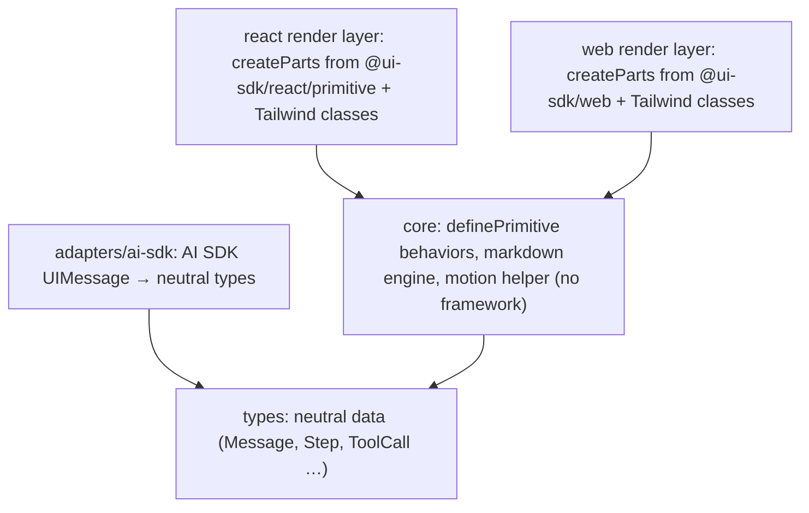

# `@kind-ui/agent-ui` design spec

- **Status:** Approved design, not implemented. Nothing in this document is a shipped API.
- **Date:** 2026-11-14
- **Repository:** [kind-ui/agent-ui](https://github.com/kind-ui/agent-ui). This repository contains only `@kind-ui/agent-ui`, its docs site, its registry, and its checks. Charts live in [kind-ui/charts](https://github.com/kind-ui/charts) and are out of scope.
- **Audience:** Kind UI maintainers and agents implementing the package, wave by wave.
- **Purpose:** Define one framework-agnostic, agent-operable AI component kit built from scratch on [UI SDK](https://ui-sdk.dev/docs), the standalone repository that builds and releases it, and the separate cleanup that retires `@kind-ui/ai` and `@kind-ui/primitives` from kind-ui/charts.
- **Background:** An earlier "AI foundations" document in kind-ui/charts (`docs/ai-foundations.md`) proposed a Base UI default, `motion/react`, and a `packages/ai` boundary inside the charts repository. This spec replaces those three choices. The foundations document's state-ownership, composer, tool-call, approval, and AI SDK mapping contracts still apply; §4.1 restates them in full so this repository does not depend on that file.

## 1. Goals and non-goals

### Goals

1. Become the go-to styled AI component kit built on UI SDK, so other developers adopt it.
2. Put Kind UI's AI components on one agent-first foundation, UI SDK, instead of Base UI.
3. Ship 41 AI components in four waves, with every agent step built on a shared Step base.
4. Keep behavior framework-agnostic. Launch with React and Web Components.
5. Make every interactive component agent-operable through named actions that work with UI SDK `createAgent` and WebMCP.
6. Meet Kind UI's product criteria: accessibility, reduced motion, explicit async states, typed contracts, and consumer-owned state.

### Non-goals

- Porting code from kind-ui/charts `packages/ai` or `packages/primitives`. `packages/ai/src` in that repository is used only as a catalog of which components exist.
- Exporting general-purpose components (button, popover, menu, and so on). They exist only to serve AI components and stay internal.
- Changing `@kind-ui/charts`, or depending on kind-ui/charts code, scripts, or configuration. This repository mirrors its tooling conventions by copying the conventions, not by importing anything.
- Vue, Svelte, and Solid render layers at launch. The architecture permits them; they are not scheduled.
- A TanStack AI adapter at launch. It is scheduled after Wave 4.
- An LLM backend, agent runtime, agent bridge, model provider, transport, store, or universal chat schema.
- Math (KaTeX), Mermaid, and raw HTML rendering in Markdown.

## 2. Architecture

### Layers



| Layer | Depends on | Must not import |
| --- | --- | --- |
| `types` | nothing | any runtime module |
| `core` | `types`, `@ui-sdk/core`, `motion`, the markdown libraries (§6) | React, other UI frameworks, `ai`, Tailwind |
| `adapters/ai-sdk` | `types`, `ai` types | `core`, React, `@ui-sdk/*` |
| `react` | `@kind-ui/agent-ui/core`, `@ui-sdk/react` | `ai`, `web` |
| `web` | `@kind-ui/agent-ui/core`, `@ui-sdk/web` | React, `ai` |

Rules:

- Each AI component is one `definePrimitive` definition in `packages/agent-ui/src/core/<component>/`. It owns state, slots, ARIA attributes, keyboard handling, `agent` actions, and `controlled` snapshot keys.
- Render layers are thin: a `createParts(primitive, tagMap)` call, Tailwind classes, and framework-specific children rendering. They contain no behavior logic. A behavior bug is fixed once, in `core`.
- Render-layer files import `core` through the public specifier `@kind-ui/agent-ui/core`, never a relative path, so the registry can copy them byte-for-byte.
- Styling uses Tailwind v4 utilities keyed on UI SDK `data-*` state attributes (for example `data-[status=running]:`, `data-open:`). Data-dependent values (progress width, token ratios) use CSS variables set by the primitive. No runtime CSS-in-JS.
- Web Components render into light DOM so Tailwind utilities and consumer styles apply. Custom element tags use the `kind-` prefix (for example `<kind-composer>`).

### Building on UI SDK

Components are built on UI SDK, not around it.

- Every public component and every internal general component is a `definePrimitive` definition, or a ready-made UI SDK component. Every React and Web Components render file renders through `createParts` (React and Web Components) or wraps a ready-made UI SDK component.
- Focus management, keyboard navigation, popups, dismissal, selection, scroll following, live announcements, and ARIA roles and states come from UI SDK: slot `role`/`focus`/`press`/`keys` declarations, UI SDK components, and `@ui-sdk/core` behaviors (for example `createRovingFocus`, `createStickToBottom`, `announce`). Hand-written versions of these are not allowed.
- Code written outside UI SDK is limited to the exceptions below. Each exception sits in a primitive's `api`, a slot's `on` handler, or a framework-free module in `core`, never in a render layer:

| Exception | Why UI SDK does not cover it |
| --- | --- |
| Streaming markdown engine (§6) | Content parsing, not interaction. |
| Motion helper presets (§6) | Animation values. Presence still uses UI SDK `animateIn` / `animateOut`. |
| Attachment removal on Delete/Backspace | Application action on a focused item. Focus movement stays with `createRovingFocus`, and the keys are declared on the slot. |
| Queue item removal on Delete/Backspace | The same action on a focused Queue row, which keeps the list to one Tab stop. Its pointer remove control is hidden from assistive technology, like Attachments'. Focus movement stays with `createRovingFocus`, and the keys are declared on the slot. |
| Composer and Uploader File Input events on Web Components | `@ui-sdk/web` reports File Input's changes only as `valuechange` and `reject` events on its own element, which don't bubble. The composer (through its form) and the uploader (through its root) hear them as they capture, and hand them to the callbacks React passes as props. |
| Conversation new-message counter | Counts messages added while not following. Following itself uses `createStickToBottom`. |
| Streaming Text append diff and Composer draft settlement | Pure data rules. |
| Clipboard writes for copy actions | `navigator.clipboard.writeText`, used only if the pinned UI SDK has no clipboard utility. |

  A new exception requires a spec change that adds a row to this table.
- Contributors and agents read the installed UI SDK docs before building a component: `node_modules/@ui-sdk/<framework>/docs/llms.txt`, plus `docs/core.md` and `docs/rendering.md` in the same package. They also use the official `ui-sdk` skill (`npx skills add vercel-labs/ui --skill ui-sdk`; a matching copy ships at `node_modules/@ui-sdk/core/skills/ui-sdk/SKILL.md`). `AGENTS.md` states this.

### Internal general components

AI components need general controls. These are UI SDK components or `@ui-sdk/core` behaviors styled for Kind UI. They live in `packages/agent-ui/src/internal/` (behavior) and `src/react/internal/` / `src/web/internal/` (render), are not in package exports, and are not documented as public API. Registry items that need them pull them in as hidden registry dependencies (§9.2).

| Internal component | UI SDK source | Used by |
| --- | --- | --- |
| Button | Button | almost all |
| Collapsible | Collapsible, `bindPanel`, `bindFindable` | Step and every Step-based component, Sources, Queue |
| Popover, Tooltip, Hover Card | Popover, Tooltip, Hover Card | Feedback, Checkpoint, Context, Inline Citation |
| Menu | Menu | Message, Document |
| Alert Dialog, Dialog | Alert Dialog, Dialog | Checkpoint, Generated Image |
| Scroll Area | Scroll Area, `createStickToBottom` | Conversation, Terminal, Code Block, Markdown Table, Document |
| Token Input, Trigger Menu | Token Input, Trigger Menu | Composer |
| File Input | File Input | Composer, Uploader |
| Combobox, Segmented Control | Combobox, Segmented Control | Model Selector, Reasoning Effort, Test Results |
| Toolbar, Toggle | Toolbar, Toggle | Message, Code Block, Feedback, Selection, Document |
| Carousel | Carousel | Suggestion, Inline Citation |
| Tree | Tree, `treeFromPaths` | File Tree, Test Results |
| Avatar | Avatar | Message, Subagent |
| Meter, Progress | Meter, Progress | Context, Plan, Uploader |
| Radio, Checkbox, Textarea | Radio, Checkbox, Textarea | Question, Feedback, Confirmation |

### Repository layout

The repository is an npm workspace. It mirrors kind-ui/charts conventions (npm 11.9 with a committed root lockfile, Node 22.22 or newer (24.11 on Node 24), strict TypeScript with NodeNext modules and explicit `.js` imports, Biome, Changesets, Tailwind v4, Vite fixtures, Playwright) without depending on that repository.

```text
agent-ui/                         # repository root (kind-ui/agent-ui)
  package.json                    # private workspace root "agent-ui-workspace"; workspaces: packages/*, apps/*
  package-lock.json
  .nvmrc                          # 22
  .npmrc
  biome.json                      # lint and format for the whole repository
  tsconfig.base.json              # strict, NodeNext, shared by every tsconfig
  AGENTS.md                       # agent routing map: commands, ownership contracts, where things live
  README.md  CONTRIBUTING.md  SECURITY.md  LICENSE
  .changeset/
    config.json                   # baseBranch main, access public
    README.md                     # release handoff (§9.3)
  .github/workflows/
    ci.yml                        # §9.4
    version.yml                   # Changesets version PR (§9.3)
    release.yml                   # exact-artifact publication (§9.3)
  packages/agent-ui/
    package.json                  # @kind-ui/agent-ui
    README.md                     # public API reference
    LICENSE
    tsconfig.json
    src/
      index.ts                    # neutral types only (explicit reexports)
      types/                      # Message, Part, Step, ToolCall, Approval, Source, …
      core/
        index.ts                  # explicit reexports of every public primitive
        step/                     # shared Step base
        conversation/ message/ composer/ …   # one folder per component
        markdown/                 # incremental engine: splitter, repair, sanitizer, AST
        motion/                   # enter/exit/layout helper over motion + UI SDK
      internal/                   # internal general-component primitives (not exported)
      adapters/ai-sdk/            # AI SDK mapping (separate entry)
      react/                      # React render layer = registry source (not in npm exports)
        internal/
      web/                        # Web Components render layer = registry source (not in npm exports)
        internal/
      styles/agent-ui.css         # Tailwind v4 source registration and theme tokens
    tests/
      core/                       # framework-independent unit tests (node --test)
      fixtures/react/             # Vite fixture app for Playwright
      fixtures/web/               # Vite fixture app for Playwright
  apps/docs/                      # docs site: component reference pages and per-wave showcase pages
  registry/
    catalog.mjs                   # agent-ui registry catalog (§9.2)
    README.md                     # registry build, naming, and consumer-check notes
  scripts/
    build-registry.mjs            # builds the shadcn registry from registry/catalog.mjs
    check-package.mjs             # packed-package gate (§10)
    check-registry-consumers.mjs  # installs registry items into clean consumers (§10)
    check-ui-sdk-usage.mjs        # fails when a component bypasses definePrimitive/createParts (§2)
    run-checks.mjs                # ordered check runner used by npm scripts and CI
  tests/
    browser/wave-<n>/*.spec.ts    # Playwright specs, both render layers
    types/                        # consumer type tests (NodeNext, Bundler, no-ai, pinned-ai)
  playwright.config.mjs           # one config; one project per wave × render layer
  artifacts/                      # generated, git-ignored (packed tarball, registry output, evidence)
```

Layout decisions:

- **One runtime package.** `packages/agent-ui` is the only published package. `apps/docs` is a private workspace that consumes the package through the workspace link and imports render-layer source the same way registry consumers do, through `@kind-ui/agent-ui/core`.
- **One docs app.** The docs site holds both component reference pages and one showcase page per wave. There is no separate showcase app.
- **One Playwright config.** Browser specs live in root `tests/browser/`, grouped by wave. `playwright.config.mjs` defines a project per wave and render layer (for example `wave-1-react`, `wave-1-web`), each serving its fixture through a Vite web server on a fixed port with Chromium.
- **Generated output stays out of git.** Package tarballs, registry output, consumer projects, and test evidence go under `artifacts/`.

### Root scripts

Every script below is defined in the root `package.json`. Package-scoped commands also exist in `packages/agent-ui/package.json` so contributors can check the package without building the docs site.

| Script | Runs |
| --- | --- |
| `build` | `tsc -b packages/agent-ui` |
| `lint` / `format` | `biome check . && node scripts/check-ui-sdk-usage.mjs` / `biome check --write .` |
| `typecheck` | `build`, then `tsc` over `tests/types/`, fixtures, `apps/docs`, and tooling scripts |
| `test:unit` | `node --test` over `packages/agent-ui/tests/core/` |
| `test:browser` | `playwright test` (accepts `--project` and `--shard`) |
| `check:package` | `node scripts/check-package.mjs` |
| `build:registry` | `node scripts/build-registry.mjs` |
| `check:registry-consumers` | `node scripts/check-registry-consumers.mjs` |
| `check:fast` | `lint`, `typecheck`, `test:unit` |
| `check:packed` | `check:package`, `build:registry`, `check:registry-consumers` |
| `check` | `check:fast`, `check:packed`, `test:browser` |
| `dev:docs` / `build:docs` | docs site dev server / production build |
| `changeset` | `changeset` |

Every new check script joins `npm run check`.

## 3. Public exports

`packages/agent-ui/package.json` `exports` (explicit; no wildcard):

| Specifier | Contents | Runtime deps |
| --- | --- | --- |
| `@kind-ui/agent-ui` | Neutral types and type guards | none |
| `@kind-ui/agent-ui/core` | Every public primitive definition (`stepPrimitive`, `composerPrimitive`, …), their option and state types, the markdown engine, the motion helper | `@ui-sdk/core`, `motion`, the markdown libraries (§6) |
| `@kind-ui/agent-ui/adapters/ai-sdk` | `fromUIMessages`, `fromUIMessagePart`, `toApprovalResponse`, `fromChatStatus` | none (`ai` types only) |
| `@kind-ui/agent-ui/styles.css` | Tailwind v4 source registration and theme tokens | none |

Dependency policy:

- `@ui-sdk/core` is a dependency pinned to an exact version (no range). The latest at spec time is `0.1.0-beta.1`; Wave 1 pins the exact version it is built and tested against.
- `@ui-sdk/react` and `@ui-sdk/web` are not dependencies of the npm package. Registry items declare them at the same exact version as `@ui-sdk/core`.
- `motion` is a dependency pinned exactly. Only its framework-agnostic API (`animate`, spring options) is used.
- The markdown libraries are dependencies pinned exactly (reason: §6): `mdast-util-from-markdown`, `mdast-util-gfm`, `micromark-extension-gfm`, `mdast-util-definitions`, `micromark-util-sanitize-uri`, `marked` (block lexer only), and `remend`.
- `ai` is an optional peer dependency used only for adapter types. A consumer without `ai` must install, typecheck, and run every entry, including the adapter's other exports.
- No React peer dependency on the npm package.

Styled React and Web Components are distributed only through the registry (§9.2). Upgrading any `@ui-sdk/*` package is a separate PR with its own changeset and a full `npm run check`.

## 4. Core types and adapters

### 4.1 Ownership and behavioral contracts

These contracts come from the earlier AI foundations work and bind every component in this spec.

**State and action ownership:**

| Concern | Owner | Component responsibility |
| --- | --- | --- |
| Messages, order, IDs, conversation status | Host/SDK | Render supplied state using stable keys |
| Transport, retries, cancellation, persistence | Host/SDK | Invoke only supplied capabilities; display explicit outcomes |
| Tool input, execution, output, and permissions | Host/SDK | Distinguish partial input, readiness, running, and terminal results |
| Approval request and accepted decision | Host/server | Submit an identified decision and display authoritative state |
| Draft text | Local or controlled host | Preserve edits on failure and while earlier submissions settle |
| Disclosure and presentation | Local or controlled host | Keep semantic keyboard and focus behavior and consumer control |
| Pending UI action and inline failure | Component or host, per documented callback | Prevent duplicate activation and ignore obsolete completions |

Components never duplicate the host conversation store. Presentation state derived from host data is computed from current props or options, not mirrored. A component's pending UI action does not authorize execution or prove persistence.

**Composer contract:**

- The composer is a real form with an accessible textarea and explicit action slots.
- Controlled and uncontrolled drafts are mutually exclusive.
- IME composition never submits, and consumer event cancellation is respected.
- Submit snapshots the draft and blocks duplicate in-flight activation. A failed or rejected submission preserves the draft. A successful acknowledgement clears only the submitted snapshot, never newer edits.
- The host callback defines acknowledgement. An SDK promise settling may mean the SDK action finished, not that the message was durably accepted; the draft is not cleared merely because a transport wrapper resolved after reporting an error elsewhere.
- Stop, retry, and submit controls render only when the host supplies the capability. The component creates no transport and never retries silently.
- Unmounting or switching conversations discards pending completions for the old draft. Pending and error UI are announced without moving focus.

**Tool call and result contract:**

- `messageId` and `toolCallId` are preserved across updates. Disclosure may be local; lifecycle is always host-supplied.
- Streaming arguments, ready input, execution, approval, and terminal outcomes stay distinguishable. Partial input is shown as partial, never as a completed request.
- `0`, `false`, `""`, and `null` are valid output. Output presence comes from the explicit field or tag, never from truthiness.
- Error, denial, and host-confirmed cancellation are separate outcomes. A chat-level interruption alone does not prove any pending tool was cancelled.
- Concurrent calls update independently by identity. Updating one tool never resets another tool's disclosure or pending interaction.
- Model output is never rendered as trusted HTML, and generated code is never evaluated.

**Approval contract:**

- The message, tool-call, and approval IDs are preserved. Each interaction binds to a specific request generation; the host validates that it is still actionable before accepting a response. A late response is never transferred to a replacement request, even in the same visual position.
- Requested, locally submitting, submission failed, response recorded, denied, and the resulting execution state are distinct.
- Duplicate activation is disabled synchronously while a response is in flight. On failure, a still-current request stays retryable. Stale success or failure after replacement, unmount, or authoritative resolution is ignored. The pending lock releases when the host reports a result for the current generation or the request is replaced.
- Only host-supplied approve and deny choices render. Automatic decisions are status, not manual controls. An "always allow" preference is host policy, not a built-in permission system. The server remains responsible for authorization, validation, and persistence.

### 4.2 Neutral types (proposed contract)

These types are the only data contract between hosts and components. Components never import SDK types.

```ts
type Role = "user" | "assistant" | "system";
type MessageStatus = "submitted" | "streaming" | "complete" | "error" | "aborted";

interface Message {
  id: string;
  role: Role;
  status: MessageStatus;
  parts: Part[];
  createdAt?: string; // ISO 8601
  metadata?: Record<string, unknown>;
}

type Part =
  | { type: "text"; id: string; text: string; state: "streaming" | "done" }
  | { type: "reasoning"; id: string; text: string; state: "streaming" | "done" }
  | { type: "file"; id: string; name: string; mediaType: string; url: string }
  | { type: "source"; id: string; source: Source }
  | { type: "step"; id: string; step: Step }
  | { type: "data"; id: string; name: string; data: unknown };

type StepStatus =
  | "pending" | "running" | "awaiting-input" | "complete" | "error" | "cancelled";

interface StepBase {
  id: string;
  status: StepStatus;
  title: string;
  startedAt?: string;
  endedAt?: string;
  error?: { message: string; detail?: unknown };
  children?: Step[];
}

type Step =
  | (StepBase & { kind: "reasoning"; text: string })
  | (StepBase & { kind: "tool"; call: ToolCall })
  | (StepBase & { kind: "task"; items: TaskItem[] })
  | (StepBase & { kind: "plan"; items: PlanItem[] })
  | (StepBase & { kind: "subagent"; agent: { id: string; name: string } })
  | (StepBase & { kind: "terminal"; command: string; output: string; exitCode?: number })
  | (StepBase & { kind: "tests"; suites: TestSuite[] })
  | (StepBase & { kind: "custom"; name: string; data: unknown });

interface ToolCall {
  toolCallId: string;
  name: string;
  dynamic: boolean;
  input: { state: "streaming" | "ready"; value: unknown };
  // Output presence is decided by this field existing, never by value truthiness.
  output?: { state: "available" | "preliminary"; value: unknown };
  outcome?: "error" | "denied" | "cancelled";
  approval?: Approval;
}

interface Approval {
  approvalId: string;
  generation: number; // increments when the host replaces a request
  state: "requested" | "submitting" | "submit-failed" | "responded" | "auto";
  decision?: { approved: boolean; reason?: string };
}
```

`Source`, `TaskItem`, `PlanItem`, and `TestSuite` are plain data records in `packages/agent-ui/src/types/` with exactly the fields their components render (§7). Type-level rules from §4.1:

- Preserve `id`, `toolCallId`, and `approvalId` across updates; components key by them.
- `0`, `false`, `""`, and `null` are valid tool output.
- `error`, `denied`, and `cancelled` are distinct outcomes. A chat-level stop does not mark pending tools `cancelled`; only host-confirmed data does.
- `approval.state === "auto"` renders as status with no manual controls.

### 4.3 AI SDK adapter

`@kind-ui/agent-ui/adapters/ai-sdk` is a pure mapping module. It never calls the SDK.

- `fromUIMessages(messages)` maps AI SDK `UIMessage[]` to `Message[]`; `fromUIMessagePart` maps one part; `fromChatStatus` maps chat status to the last message's `MessageStatus`.
- Tool part states map as below. The source states were observed in `ai@7.0.136` during the earlier foundations audit. Wave 1 rechecks them against the exact pinned `ai` version (latest at spec time: `7.0.173`) and records differences in the adapter section of `packages/agent-ui/README.md`.

| AI SDK state | Neutral result |
| --- | --- |
| `input-streaming` | `input.state = "streaming"`; Step `running` |
| `input-available` | `input.state = "ready"`; Step `running` |
| `approval-requested` | `approval.state = "requested"`; Step `awaiting-input` |
| `approval-responded` | `approval.state = "responded"`, decision preserved; Step `running` |
| `output-available` | `output` set (`preliminary` when the SDK marks it); Step `complete` |
| `output-error` | `outcome = "error"`, input preserved; Step `error` |
| `output-denied` | `outcome = "denied"`; Step `cancelled` |

- The mapper never guesses absent states. Execution progress and cancellation appear only when host data supplies them.
- Static (`tool-<name>`) and dynamic tools both map, with `dynamic` set accordingly. Opaque approval metadata is preserved and never treated as authorization.
- Unknown part types map to `{ type: "data" }` and never throw.
- `toApprovalResponse(approval, decision)` returns the argument the host passes to the SDK's approval-response function.
- Tests use fixtures only: compile-time assignability against the pinned SDK types and runtime mapping of every state. No model provider and no paid requests.

## 5. Step base

All agent steps share one primitive: every step component builds on a common Step base.

**Parts:** `root`, `trigger`, `icon`, `title`, `meta` (duration, counts), `content`, `children`.

**Behaviors:**

- Collapsible content via `bindPanel`, with `bindFindable` so find-in-page reveals collapsed text.
- `StepList` groups sibling step triggers under `createRovingFocus`: one Tab stop, arrow keys between steps, Home and End.
- `createFocusRecovery` keeps focus valid when a step is removed.
- `announce` (polite) fires only on transitions to `awaiting-input`, `complete`, `error`, and `cancelled`. Streaming updates are never announced.

**Options:** `status`, `label`, `open` / `defaultOpen` / `onOpenChange`, `autoOpen: "running" | "never"` (default `"running"`), `motion` (§6).

**Auto open and close:** With `autoOpen: "running"`, a step opens when it enters `running` or `awaiting-input` and closes when it reaches `complete`. It stays open on `error`. Once a person or agent toggles a step, auto behavior stops for that step. Find in page counts as a person: a step it opens stays open when it completes.

**Web Components `title`:** the option that names a step in announcements is `label` in both render layers, not `title`. On `<kind-step>`, `title` is HTML's advisory attribute: it stays on the element, so it is the tooltip over the whole step, and Chromium reads it as the step's accessible description (checked in Wave 2 Task 1).

**Attributes:** `data-status`, `data-open`, `data-kind`, and `--kind-step-duration` (seconds, when known).

**Agent actions:** `expand`, `collapse`. **Snapshot keys:** `open`, `status`.

Built on Step: Reasoning, Chain of Thought, Tool, Task, Plan, Subagent, Action, Terminal, Stack Trace, and Test Results. `stepPrimitive` is public so consumers can build custom steps.

## 6. Cross-cutting approaches

### Motion

- Animation uses `motion`'s framework-agnostic `animate` with spring options, plus UI SDK `animateIn` / `animateOut` for presence.
- An in-house helper in `packages/agent-ui/src/core/motion/` provides three framework-agnostic functions:
  - `enter(el, preset)`: applies the start state and animates in.
  - `exit(el, preset): Promise<void>`: keeps the element mounted until the exit finishes, then resolves. Calling `enter` during an exit reverses from the current value.
  - `layout(el, measureBefore)`: FLIP animation for size or position changes (step expand, queue reorder).
- Every animated primitive accepts `motion: "auto" | "reduced" | "none"` (default `"auto"`, which follows `prefers-reduced-motion`).
- Every animation has a reduced version: no translation, scale, or height animation; at most a 120 ms opacity fade. `"none"` applies the final state instantly.
- Loading indicators (Loader, Thinking Indicator, Typing Indicator) use a smooth staggered fade that flows across their dots, never synchronized blinking. Reduced motion shows the label and dots at steady opacity.
- Streaming updates never remount active inputs or move the reader's scroll position.
- **Removed items:** a component that renders items from host data (Queue, Attachments, Uploader) keeps a removed item as a leaving row until its exit finishes.
  - The row stays in place, `inert` and `aria-hidden`, and plays the `"fade"` preset through `exit`. The rows after it then move into place with `layout`.
  - Leaving rows aren't in the component's items, the agent snapshot or roving focus.
  - Under reduced motion the row fades for 120 ms and nothing slides; under `"none"` it leaves at once.
  - Components whose children the host renders (Conversation rows, nested steps) remove a child at once.

### Streaming Markdown renderer

This is the hardest piece. `core` owns a framework-agnostic engine built from framework-agnostic open-source parts, so Kind UI writes only the glue:

1. **Block splitting.** The `marked` block lexer splits source into top-level blocks, and only the text after the final blocks is lexed again on append. A block is final once it ends with a blank line and is followed by two more blocks: final blocks are immutable, keyed by `index:hash`, and never re-parsed. A document with link reference definitions outside code stays one block. Footnotes split like any other block, a definition together with its indented continuation: a footnote reference renders as its own text whether or not its definition shares the parse (a reference directly followed by `(url)` renders as a link when split).
2. **Tail parsing.** On each append, only the open (non-final) blocks are parsed, with `mdast-util-from-markdown`, `micromark-extension-gfm`, and `mdast-util-gfm`. These are framework-agnostic and CommonMark/GFM compliant, so Kind UI does not maintain a parser.
3. **Repair.** While streaming, the last block is repaired with `remend` (self-healing markdown) before parsing: unterminated emphasis, inline code, and strikethrough are closed and an unfinished link shows its text, so partial syntax does not flash as raw text. An open code fence needs no repair: CommonMark runs it to the end of the block. Repair never applies to final blocks.
4. **Sanitize.** Raw HTML renders as text. Link and image URLs allow `http:`, `https:`, `mailto:`, and relative URLs, checked with micromark's `sanitizeUri`; any other URL renders its label as plain text. Generated code is never evaluated.
5. **Render.** The engine emits a neutral AST. The React layer maps it to elements keyed by block key. The Web Components layer maps it to DOM nodes and patches only the tail block.

Code highlighting is pluggable through `highlight?: (code, lang) => Promise<Token[]>`. No highlighter ships by default. Code Block renders plain text until tokens resolve and discards results for outdated code.

**Acceptance:** streaming a 10,000-token fixture in 20-character chunks parses only the tail block per append, and final blocks keep DOM node identity, in both render layers.

### Agent actions

- Each primitive declares `agent: { actions: [...] }` and `controlled` snapshot keys in its `definePrimitive` definition. This spec writes actions as `component.action` (for example `composer.submit`); a snapshot shows them as `component: "composer"`, `actions: ["submit"]`.
- An action is listed only while available. `composer.stop` appears only while a submission is in flight and the host supplies `onStop`. Host-callback actions (for example `message.regenerate`) appear only when the host supplies the callback. On Web Components, where a listener can't be seen, a `can-<action>` boolean attribute (for example `can-regenerate`) stands for the callback, and the callback is a DOM event.
- Actions run the same code paths as pointer and keyboard input. Change callbacks receive `details.source === "agent"` so hosts can distinguish and cancel agent changes.
- These consequential actions render `data-agent-confirm`, so `createAgent` permissions and WebMCP `registerTools` `allow` require a person: `composer.submit`, `confirmation.approve`, `confirmation.deny`, `checkpoint.restore`, `plan.accept`, `subagent.cancel`, `question.submit`. Confirmation's marking cannot be turned off; the others accept the primitive option `agentConfirm: false`.
- Every component root with a role requires an accessible name; agents address components by that label or by `ref`. Markdown and Streaming Text are content with no role, which ARIA does not let a name sit on, and offer no actions.
- Kind UI ships no agent bridge. Hosts create one with `createAgent` from `@ui-sdk/react/agent` or `@ui-sdk/web/agent`. Docs show both, plus `registerTools` for WebMCP.

## 7. Components by wave

Each wave is a minor release of `@kind-ui/agent-ui` (0.1 to 0.4) with its registry items, docs reference pages, and docs showcase page. "Replaces" names the kind-ui/charts `packages/ai/src` file used as a catalog reference, kind-ui/charts#253 (unmerged), or "(new)" for new additions.

### Wave 1 (0.1): foundation

| Component | Composes (UI SDK) | Agent actions | Replaces |
| --- | --- | --- | --- |
| **Step** (+ StepList) | Collapsible, `bindPanel`, `bindFindable`, `createRovingFocus`, `createFocusRecovery`, `announce` | `expand`, `collapse` | (new base) |
| **Conversation** | Scroll Area, `createStickToBottom`, `createVirtualizer`, `createFocusRecovery`, `announce` | `scrollToEnd` | conversation |
| **Message** | Toolbar, Menu, Avatar, `createInlineEdit` | `copy`, `regenerate`, `edit`, `setBranch(index)` | message |
| **Markdown** | markdown engine | none | markdown, markdown-context |
| **Code Block** | Button, Toggle, Scroll Area, `announce` | `copy`, `toggleWrap` | markdown-code-block |
| **Markdown Table** | Scroll Area, `cellsToText` | `copy` | markdown-table |
| **Composer** | Token Input, Trigger Menu, File Input, `createInputHistory`, `isComposing`, Button | `setValue`, `insertToken`, `removeAttachment(id)`, `submit`, `stop` | prompt-input, composer-rich |
| **Attachments** | `createRovingFocus`, Button | `remove(id)` | attachments |
| **Uploader** | File Input, Progress, `announce` | `cancel(id)`, `retry(id)` | uploader |
| **Loader** | none | none | loader |
| **Thinking Indicator** | motion helper | none | thinking-dots, kind-ui/charts#253 |
| **Typing Indicator** | motion helper | none | kind-ui/charts#253 |
| **Streaming Text** | motion helper | none | kind-ui/charts#253 |

Behavior requirements:

- **Conversation:** a `role="log"` region with an accessible name. It follows the end while the reader is at the bottom. Scrolling up stops following and shows a "Jump to latest" button that announces the number of new messages; activating it scrolls to the end and resumes following. `virtualize: boolean` (default `false`) enables `createVirtualizer` with measured row heights; docs recommend it above 200 messages. Includes an empty-state part.
- **Message:** `data-role` and `data-status` attributes. When `branchCount > 1`, a branch switcher shows "n of m" with previous and next buttons. User messages edit in place with `createInlineEdit`: Escape cancels, commit calls `onEdit`.
- **Composer:** a real `<form>`. Typing `@` opens mentions and `/` opens commands through Trigger Menu; choices insert Token Input tokens. Attachments come from choose, drop, or paste through File Input, with host-supplied `accept` and `maxSize` validation errors shown inline. `submitOn: "enter" | "mod-enter"` defaults to `"enter"` (Shift+Enter inserts a newline); IME composition never submits. ArrowUp in an empty field recalls earlier prompts via `createInputHistory`. Submit snapshots the draft and blocks duplicate activation. If `onSubmit` rejects, the draft stays; when it resolves, only the submitted snapshot clears, never newer edits. Controlled (`value` + `onValueChange`) and uncontrolled (`defaultValue`) drafts are mutually exclusive. The full composer contract is in §4.1.
- **Uploader:** per-file progress, error, cancel, and retry from host-supplied state and callbacks.
- **Indicators:** `role="status"` with an accessible label (defaults: "Loading", "Thinking", "Typing"); visual dots are `aria-hidden`. Streaming Text fades in each appended chunk and shows an optional caret; reduced motion appends instantly.

### Wave 2 (0.2): agent activity

| Component | Composes | Agent actions | Replaces |
| --- | --- | --- | --- |
| **Reasoning** | Step, Markdown | `expand`, `collapse` | reasoning |
| **Chain of Thought** | Step, StepList | `expand`, `collapse`, `expandStep(id)` | chain-of-thought |
| **Tool** | Step, Code Block, Markdown | `expand`, `collapse`, `copyInput`, `copyOutput` | tool |
| **Task** | Step, `createRovingFocus` | `expand`, `collapse` | task |
| **Plan** | Step, StepList, Progress | `expand`, `collapse`, `accept` | plan |
| **Queue** | Collapsible, `createReorder`, `createRovingFocus`, `reorderMessage` | `reorder(id, index)`, `remove(id)` | queue |
| **Subagent** | Step, StepList, Avatar | `expand`, `collapse`, `cancel` | agent-run |
| **Status** | `announce` | none | status |

Behavior requirements:

- **Reasoning:** the title reads "Thinking" while streaming and "Thought for N s" when done. Auto open and close follow Step.
- **Tool:** the header shows tool name and status. Content shows input (labeled "Partial" while `input.state === "streaming"`), output, or error. In this wave `approval.state` renders as status; approve and deny controls arrive with Confirmation in Wave 3. Concurrent tools update independently by `toolCallId` without resetting each other's open state.
- **Plan:** ordered items with per-item status and overall Progress. `accept` appears only when the host supplies `onAccept`.
- **Queue:** pending and completed sections. Reorder and remove appear only when the host supplies `onReorder` / `onRemove`; reordering works by pointer and keyboard and is announced.
- **Subagent:** nested steps and a result section; `cancel` appears only when the host supplies `onCancel`.
- **Status:** a compact badge with icon and text for run status; announces changes politely.

### Wave 3 (0.3): human input

| Component | Composes | Agent actions | Replaces |
| --- | --- | --- | --- |
| **Confirmation** | Button, Textarea, `announce` | `approve`, `deny(reason?)` | confirmation |
| **Question** | Radio, Checkbox, Textarea, `createRovingFocus` | `select(questionId, value)`, `setText(questionId, text)`, `submit`, `skip` | question |
| **Checkpoint** | Button, Tooltip, Alert Dialog | `restore` | checkpoint |
| **Model Selector** | Combobox, `fuzzyScore`, `matchSegments` | `setValue` | model-selector |
| **Reasoning Effort** | Segmented Control | `setValue` | kind-ui/charts#253 |
| **Suggestion** | Carousel, Button | `pick(id)` | suggestion |
| **Context** | Meter, Hover Card | `open`, `close` | context |
| **Feedback** | Toggle, Popover, Textarea | `rate("up" \| "down" \| null)`, `submitComment` | feedback-bar |
| **Notice** | Button, `announce` | `dismiss` | callout |
| **Guardrail Notice** | Notice, Collapsible | `dismiss`, `expand`, `collapse` | kind-ui/charts#253 |

Behavior requirements:

- **Confirmation:** bound to `approvalId` and `generation`. Activation disables both choices synchronously. `submit-failed` re-enables them while the request is current. Results for a replaced generation, an unmounted component, or a host-resolved request are ignored. Only host-supplied choices render; `auto` approvals render as status. Tool embeds Confirmation when `call.approval` is present. The full approval contract is in §4.1.
- **Question:** single choice, multiple choice, and free text, as one question or a sequence. `submit` is disabled until required answers exist; `skip` appears only when the host supplies `onSkip`.
- **Checkpoint:** `restore` opens an Alert Dialog before calling `onRestore`.
- **Model Selector:** grouped options with fuzzy search and match highlighting. Reasoning Effort is a separate component placed beside it.
- **Context:** Meter shows used and total tokens with accessible value text; Hover Card lists input, output, reasoning, and cached tokens and cost when supplied.
- **Feedback:** `rate` toggles thumbs up or down; `submitComment` sends the optional comment through `onComment`.
- **Notice:** variants `info`, `success`, `warning`, `error`; `dismiss` appears only when the host supplies `onDismiss`. Guardrail Notice adds a policy reason and an optional expandable detail, and uses `role="alert"` only when the outcome blocks the response.

### Wave 4 (0.4): artifacts and developer output

| Component | Composes | Agent actions | Replaces |
| --- | --- | --- | --- |
| **Sources** | Collapsible | `expand`, `collapse` | sources |
| **Inline Citation** | Hover Card, Carousel | `open`, `close`, `next`, `previous` | inline-citation |
| **Document** | Toolbar, Menu, Scroll Area, Collapsible | `copy`, `download`, `expand`, `collapse` | document |
| **Generated Image** | Dialog, Button | `open`, `close`, `download` | generated-image |
| **File Tree** | Tree, `treeFromPaths`, `createTypeahead` | `expand(path)`, `collapse(path)`, `select(path)` | (new) |
| **Terminal** | Step, Scroll Area, `createStickToBottom`, `createVirtualizer` | `expand`, `collapse`, `copy` | (new) |
| **Stack Trace** | Step, `createRovingFocus` | `copy`, `toggleLibraryFrames`, `openFrame(index)` | (new) |
| **Test Results** | Step, Tree, Segmented Control | `setFilter(status)`, `expand(id)`, `collapse(id)` | (new) |
| **Transcript** | `createRovingFocus`, `fuzzyScore`, `matchSegments` | `search(text)`, `seek(segmentId)` | transcript |
| **Selection** + **Action** | Selection: Toolbar, `position`, `bindLayer`. Action: Step | Selection: `run(actionId)`, `dismiss`. Action: `expand`, `collapse` | selection, action |

Behavior requirements:

- **Document:** `download` appears only when the host supplies `onDownload`.
- **Generated Image:** explicit `loading`, `loaded`, and `error` states; the zoom Dialog restores focus on close.
- **File Tree:** change badges (`added`, `modified`, `deleted`) come from data; `select` calls `onSelect`.
- **Terminal:** an in-house parser turns ANSI SGR color codes into styled spans (never HTML). Output follows the end like Conversation. Shows the exit code when present.
- **Stack Trace:** library frames are collapsed by default; `openFrame` appears only when the host supplies `onOpenFrame`.
- **Test Results:** pass, fail, and skip counts; failures embed Stack Trace.
- **Transcript:** speaker-attributed, time-coded segments with word highlighting driven by host-supplied `currentTime`; `seek` calls `onSeek`.
- **Selection:** a floating toolbar anchored to the current text selection inside its root; Escape and outside press dismiss it.

Component count: 13 + 8 + 10 + 10 = 41 rows, with Selection and Action counted as one family.

## 8. Accessibility requirements

These apply to every component:

- Keyboard-only paths for every action, following the conventions of the UI SDK components it composes.
- An accessible name on every root; agent snapshot labels come from the same names.
- Polite announcements at terminal transitions only; never token by token.
- Focus moves only in response to a person or agent action, or where the pattern requires it (dialogs).
- Color is never the only status signal; every status has an icon and text.

## 9. Distribution and release

### 9.1 npm package

`@kind-ui/agent-ui` ships the exports in §3. The package starts private at `0.0.0` and becomes public at 0.1 only with explicit publication authorization. Each wave is one minor release (0.1 to 0.4). Before 1.0, breaking API changes increment the minor version and compatible fixes increment the patch version.

### 9.2 Registry

Styled React and Web Components ship as copy-in shadcn registry items from this repository's own registry. Nothing extends or imports the kind-ui/charts registry.

- `registry/catalog.mjs` lists every item. `scripts/build-registry.mjs` reads it, stages item files, and runs a pinned `shadcn` CLI `build` executed ephemerally (not added to the dependency tree), writing the flat served catalog (`registry.json`) and per-item payloads (`<name>.json`) to `artifacts/registry/r/`.
- Item names are `<component>` for React and `<component>-web` for Web Components (for example `composer` and `composer-web`), with no product prefix. Consumers address them through the registry namespace (for example `@kind-ui/composer`).
- Internal general components ship as hidden `internal-<name>` items (for example `internal-button`), referenced through `registryDependencies` and excluded from docs listings.
- Item names must be unique across the shared `@kind-ui` namespace, which also holds charts' items (§9.6). The build fails on duplicate names within this catalog; the release and the kindui.dev deployment fail on collisions with charts' items.
- Item files are copied byte-for-byte from `packages/agent-ui/src/react/` or `packages/agent-ui/src/web/`. The build fails if a staged file differs from its source.
- Items pin `@kind-ui/agent-ui`, `@ui-sdk/core`, and `@ui-sdk/react` or `@ui-sdk/web` to exact versions. The build fails when the catalog's `@kind-ui/agent-ui` version differs from `packages/agent-ui/package.json`, or when an item's `@ui-sdk/*` version differs from the package's `@ui-sdk/core` pin.
- The item `css` field registers `@kind-ui/agent-ui/styles.css` (theme tokens and Tailwind v4 source registration) for the standard `src/`, `app/`, and `src/app/` stylesheet locations. Consumers with other layouts import it from their own stylesheet. Existing consumer theme variables remain authoritative.
- Catalog file entries omit `content`; item payloads include source content. The catalog conforms to the official shadcn registry schema.
- The build output is served from kindui.dev as described in §9.6. Submitting the namespace to the shadcn directory is not part of any build or check.

### 9.3 Changesets and release workflow

- **Changesets.** `.changeset/config.json` uses base branch `main` and public access. User-facing package changes require a reviewed changeset. Documentation, CI, and development-only changes need none. Ordinary merges never bump versions.
- **Version PR.** `.github/workflows/version.yml` runs on pushes to `main` with pending changesets and opens a draft version PR that updates `packages/agent-ui/package.json`, its changelog, and the lockfile.
- **Release.** `.github/workflows/release.yml` runs when a merged version PR changes `packages/agent-ui/package.json` on `main`, or by manual dispatch with the expected version and dist-tag. It is guarded by `github.repository == 'kind-ui/agent-ui'` and runs four jobs in order:
  1. **Plan:** confirm a reviewed Changesets version transition exists.
  2. **Validate:** `npm ci`, `npm audit --audit-level=high --include=dev`, install Chromium, `npm run check`, and retain the tested tarball as a workflow artifact.
  3. **Verify:** recompute the retained tarball's SHA-256 and integrity, confirm it matches the expected version, and check whether that version already exists on npm with matching integrity.
  4. **Publish:** in the protected `npm-release` environment with `id-token: write`, publish the exact verified tarball with `npm publish <tarball> --ignore-scripts --access public --tag <dist-tag>` (no repacking), then confirm the public integrity matches. A final job records the version and checksums in a GitHub release.
- CI success alone does not authorize publication. Publishing requires the `npm-release` environment approval and npm trusted publishing configured for `kind-ui/agent-ui` on the `@kind-ui` scope.

### 9.4 CI

`.github/workflows/ci.yml` runs on pull requests and pushes to `main`, on Node 22 with npm 11.9.0, with third-party actions pinned by commit SHA and read-only `contents` permission:

| Job | Runs |
| --- | --- |
| Fast | `npm ci`, `npm audit --audit-level=high --include=dev`, `npm run check:fast` |
| Packed | `npm run check:packed`; uploads the tarball and registry consumer evidence |
| Browser | Installs Chromium and runs `npm run test:browser`, sharded; uploads Playwright traces and screenshots on failure |
| All checks | Required status. Fails unless every job above succeeded |

All jobs run on every change; this repository has one product, so there is no path-based job selection.

### 9.5 Docs site

`apps/docs` gains one reference page per component covering exports, options, state ownership, callbacks, errors, keyboard behavior, agent actions, tested versions, and runnable React and Web Components examples, plus one showcase page per wave. Pages ship in the same wave as their components. The site's build is `npm run build:docs`, with base path `/agent-ui/`; it is served as described in §9.6.

### 9.6 Hosting

Decision: the docs site and registry are served from kindui.dev, and the registry shares the existing `@kind-ui` shadcn namespace with charts.

| Output | Built by | Served at |
| --- | --- | --- |
| Docs site | `npm run build:docs` (base path `/agent-ui/`) | `https://kindui.dev/agent-ui/` |
| Registry items | `npm run build:registry` → `artifacts/registry/r/<name>.json` | `https://kindui.dev/r/<name>.json`, beside charts' items |
| Registry catalog | `npm run build:registry` → `artifacts/registry/r/registry.json` | Merged with charts' items into the single `https://kindui.dev/r/registry.json` |

Consumers install with the existing namespace, for example `npx shadcn@latest add @kind-ui/composer`.

- **Handoff.** After a successful publish, the release workflow (§9.3) builds the docs site and registry from the released commit and attaches them as one `agent-ui-site-<version>.tar.gz` asset, with its SHA-256, to the GitHub release. The served docs and registry therefore always match a published npm version.
- **Deployment.** The kindui.dev deployment is owned by kind-ui/charts. It downloads the asset from the latest kind-ui/agent-ui GitHub release, verifies the checksum, serves the docs under `/agent-ui/`, copies item payloads into `/r/`, and merges both catalogs into one `registry.json`. Making that change to the kindui.dev deployment is a task in kind-ui/charts, required before the 0.1 release.
- **Collisions.** The release workflow's validate job fetches `https://kindui.dev/r/registry.json` and fails if any agent-ui item name matches a live catalog item that is not listed in the previous agent-ui release's catalog, meaning a charts item. The kindui.dev deployment also fails on duplicate names when merging. Neither repository silently overwrites the other's items.

## 10. Testing

| Layer | What | Where |
| --- | --- | --- |
| Core unit | Keyboard, focus, state transitions, Step auto open/close, composer draft snapshots, approval generations, markdown block finality, repair, URL sanitizing, ANSI parsing, adapter mapping | `packages/agent-ui/tests/core/`, with `@ui-sdk/core/testing` and `node --test` (`npm run test:unit`) |
| Browser | Each component in the React and Web Components fixtures: rendering, keyboard-only paths, axe scan (`@axe-core/playwright`), streaming, scroll following | `tests/browser/wave-<n>/`, run by `playwright.config.mjs` projects per wave and render layer (fixed port, Chromium, Vite fixture web server) |
| UI SDK usage | Static check: every public component in `src/core/<component>/` is a `definePrimitive` result, every render file under `src/react/` and `src/web/` (including `internal/`) uses `createParts` or wraps a UI SDK component, and no file outside the exception list in §2 "Building on UI SDK" contains hand-written focus, key, scroll, or ARIA code. Runtime proof: the per-component `createAgent` snapshot test (next row), since the bridge registers only UI SDK primitives. | `scripts/check-ui-sdk-usage.mjs` (part of `npm run lint`) |
| Agent actions | For each component, the `createAgent` snapshot lists the expected actions and keys; `act` runs each action and the resulting state matches; `data-agent-confirm` steps are refused without approval | Browser specs, both render layers |
| Reduced motion | Each animated component under `reducedMotion: "reduce"` runs no transform or height animation and reaches its final state | Browser specs |
| Types | Consumers compile under NodeNext and Bundler resolution; a core consumer compiles and runs without `ai`; the adapter compiles against pinned `ai` types | `tests/types/`, included in `npm run typecheck` |
| Packed package | `npm pack` tarball exports resolve; `core` has no React or `ai` runtime import; CSS is included; `publint` and `@arethetypeswrong/cli` pass; a clean consumer installs the tarball without `ai` and imports every entry | `scripts/check-package.mjs` (`npm run check:package`) |
| Size | Each public JS entry, bundled with its dependencies, minified and gzipped, stays within its limit | `size-budget.json`, `scripts/check-size.mjs` (`npm run check:size`) |
| Count budgets | DOM writes, renders, parts notified, layout reads and markdown parses per streamed delta stay within fixed counts at 10 and 500 rows; mounting and unmounting Conversation leaves no DOM nodes or listeners | `tests/browser/wave-1/budgets.spec.ts` |
| Registry consumers | Each wave's items install from the local registry build and local tarball into clean Vite React and Vite Web Components consumers under `artifacts/`, then build and render; installed `@ui-sdk/*` and `@kind-ui/agent-ui` versions match the pins | `scripts/check-registry-consumers.mjs` (`npm run check:registry-consumers`) |

Tests use fixtures and explicitly resolved deferred promises; no live services and no timing sleeps. Accessibility automation is supplemented by manual keyboard and screen-reader review of each wave's fixtures before release.

## 11. Migration and cleanup

`@kind-ui/ai` and `@kind-ui/primitives` in kind-ui/charts are private at `0.0.0` and unpublished, so removing them breaks no external users. Their cleanup is a separate task in kind-ui/charts and is not gated on any agent-ui wave.

1. **Cleanup in kind-ui/charts (separate PR in that repository, any time):** delete `packages/ai` and `packages/primitives`; their scripts (`scripts/check-ai-package.mjs`, `scripts/check-primitives-package.mjs`, `scripts/build-primitives-registry.mjs`); their Playwright configs (`playwright.ai-*.config.mjs`, `playwright.primitives.config.mjs`) and tests and fixtures; their `package.json` script entries and the references in aggregate scripts (`build`, `test:unit`, `check:types`, `check:packed`); their CI artifact paths; their docs and showcase pages; and `docs/ai-foundations.md`, replaced by a pointer to this spec. After cleanup, kind-ui/charts covers charts only.
2. **Close kind-ui/charts#253** with a comment linking this spec. Its components are rebuilt here: ThinkingIndicator, StreamingText, and TypingIndicator in Wave 1; ReasoningEffort and GuardrailNotice in Wave 3.
3. **Superseded branch:** the kind-ui/charts branch `bhaveshchow20-agent-ui-design-spec`, which held the earlier monorepo version of this spec, is superseded by this document and is not merged.

## 12. Risks

| Risk | Impact | Mitigation |
| --- | --- | --- |
| UI SDK is beta (released 2026-11-12) | Breaking changes, missing behaviors, bugs | Exact pins on every `@ui-sdk/*` package; upgrades are separate PRs with full checks; Kind primitives wrap UI SDK so consumers see Kind's contract; report upstream bugs instead of forking |
| Web Components light-DOM rendering | Tailwind utilities cannot style shadow DOM parts | Wave 1 builds the Composer Web Component first and proves light-DOM rendering with `@ui-sdk/web` `createParts`; if it fails, Wave 1 stops and this spec is revised before other components start |
| Streaming Markdown engine | Correctness, performance, and security | Reuse mdast/micromark parsing; tail-only parsing; finality and sanitizer tests; the 10,000-token acceptance test in both render layers |
| Motion helper | Exit and layout bugs across frameworks | Small helper over UI SDK `animateIn` / `animateOut` and `motion` `animate`; interruption and reversal tests; a reduced path for every animation |
| Virtualization with streaming rows | Scroll jumps or lost reader position | `virtualize` is opt-in; browser tests stream into the last row while scrolled up and assert a stable position |
| Scope of 41 components | Waves slip | Waves ship independently; a wave's checks pass before the next wave starts |
| New repository tooling | Wave 1 also carries workspace, CI, and release setup | The Wave 1 foundation PR lands tooling with the Step and Composer primitives only; later Wave 1 components follow in their own PRs |

## 13. Open questions

None. Registry and docs hosting, formerly open, is decided in §9.6.
