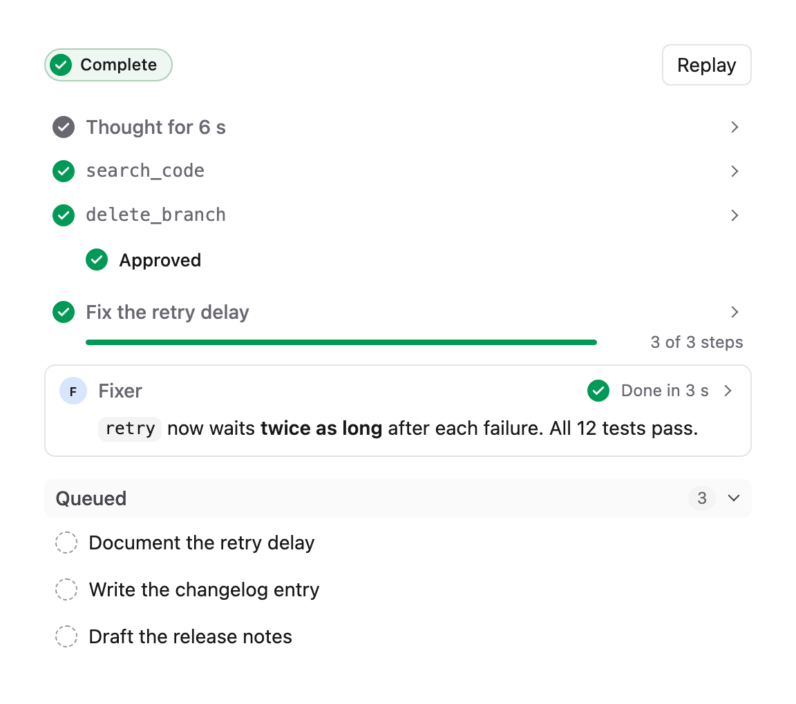

# @kind-ui/agent-ui

AI interface components that people and agents can both use, for React and Web Components, built on [UI SDK](https://ui-sdk.dev/docs).

[](https://www.npmjs.com/package/@kind-ui/agent-ui)
[](https://github.com/kind-ui/agent-ui/actions/workflows/ci.yml)
[](https://github.com/kind-ui/agent-ui/blob/main/LICENSE)

[Docs](https://kindui.dev/docs/agent-ui/) · [Components](https://kindui.dev/docs/agent-ui/components/step/) · [GitHub](https://github.com/kind-ui/agent-ui) · [Changelog](https://github.com/kind-ui/agent-ui/blob/main/packages/agent-ui/CHANGELOG.md)



```bash
npm install @kind-ui/agent-ui @ui-sdk/core
```

| Entry | Contents |
| --- | --- |
| `@kind-ui/agent-ui` | Neutral types and type guards |
| `@kind-ui/agent-ui/core` | Public primitive definitions, the markdown engine, the motion helper |
| `@kind-ui/agent-ui/adapters/ai-sdk` | AI SDK `UIMessage` mapping (`ai` is an optional peer) |
| `@kind-ui/agent-ui/styles.css` | Tailwind v4 source registration and theme tokens |

Styled React and Web Components are distributed through the [registry](#registry), not this package.

[Components](https://kindui.dev/docs/agent-ui/): Step and Step List, Status, Reasoning, Tool, Chain of Thought, Task, Plan, Subagent, Queue, Confirmation, Question, Checkpoint, Model Selector, Reasoning Effort, Suggestion, Context Meter, Feedback, Notice, Guardrail Notice, Conversation, Message, Markdown, Code Block, Markdown Table, Composer, Attachments, Uploader, Loader, Thinking Indicator, Typing Indicator, Streaming Text, Sources, Inline Citation, Document, Generated Image, File Tree, Terminal, Stack Trace, Test Results, Transcript, Selection, Action, Picker, Add Menu, Settings Menu, Approval Mode, Model Control, Context Bar, Dictation, Thread List, Thread Search, Sidebar, Day Separator, Connection Status, Share Dialog and Conversation Search.

## Registry

Add the `@kind-ui` namespace to your `components.json`:

```json
{
  "registries": {
    "@kind-ui": "https://kindui.dev/r/{name}.json"
  }
}
```

Then install a component with `npx shadcn@latest add @kind-ui/<name>`: `<component>` for React (for example `@kind-ui/composer`) and `<component>-web` for Web Components (`@kind-ui/composer-web`). The CLI copies the component into your `ui` directory, installs this package and UI SDK at the pinned versions, imports `styles.css` into your stylesheet, and writes an `AGENTS.md` for coding agents beside the components. Tailwind finds the copied files on its own; if they live outside the app that builds them, add an `@source` for them to your stylesheet.

## Styles

Import `@kind-ui/agent-ui/styles.css` after `tailwindcss` in your stylesheet. It registers the components' styles and declares the theme tokens under `@theme default`, so your own `@theme` or `:root` values win:

```css
@import "tailwindcss";
@import "@kind-ui/agent-ui/styles.css";

:root {
  color-scheme: light dark;
  --kind-color-accent: var(--color-violet-600);
  --kind-radius: 0.5rem;
}
```

| Token | Use |
| --- | --- |
| `--kind-color-fg`, `--kind-color-muted` | Text and secondary text |
| `--kind-color-surface`, `--kind-color-hover`, `--kind-color-border`, `--kind-color-ring`, `--kind-color-shadow` | Backgrounds, subtle fills, borders, focus rings, shadows |
| `--kind-color-accent`, `--kind-color-on-accent` | Running and primary states, and text on them |
| `--kind-color-success`, `--kind-color-warning`, `--kind-color-danger`, `--kind-color-on-status`, `--kind-color-on-warning` | Statuses, and marks on them (`on-warning` on the warning fill) |
| `--kind-radius` | Base corner radius; others scale from it |
| `--kind-font-mono` | Code |
| `--kind-ansi-black` … `--kind-ansi-white`, `--kind-ansi-bright-black` … `--kind-ansi-bright-white` | Terminal's 16 named ANSI colors |
| `--kind-status-mark-size` | Status mark size (default 16px, even pixels only) |

Colors are `light-dark()` pairs, so dark mode follows `color-scheme`: `light dark` follows the system, and a class-based dark theme sets `color-scheme: dark` on its root. A Code Block `highlight` function can return `light-dark()` token colors to switch with them.

Tailwind writes the defaults on `:root, :host`, so inside a shadow root that loads this stylesheet, set your values on `:host` too.

## AI SDK adapter

`@kind-ui/agent-ui/adapters/ai-sdk` maps AI SDK `UIMessage`s to the neutral types. It imports `ai` with `import type` only and never calls the SDK, so its emitted JavaScript has no `ai` import. A consumer without `ai` can still import `toApprovalResponse` and `fromChatStatus`. Its declarations type-check without `ai` too, even with `skipLibCheck` off: there, the `ai` types it references are `any`.

| Export | Maps |
| --- | --- |
| `fromUIMessages(messages, { status, error }?)` | `UIMessage[]` to `Message[]`. `status` and `error` apply to the last message, and earlier messages are `"complete"`. Takes `status` alone too. |
| `fromUIMessagePart(part, { messageId, index })` | One part. Returns `null` only for `step-start`. |
| `fromChatStatus(status)` | `submitted`, `streaming`, `ready` → `complete`, `error` |
| `toApprovalResponse(approval, decision)` | The argument for `addToolApprovalResponse`: `{ id: approval.approvalId, approved, reason? }` |

### Tested AI SDK version

Tested against `ai@7.0.173`. The spec §4.3 tool states were observed in `ai@7.0.136`. All seven states (`input-streaming` through `output-denied`) are unchanged in `7.0.173`. Differences and adapter decisions:

- **New part types:** `custom`, `reasoning-file`, and the experimental `steering-message` have no neutral counterpart. Like any unknown type, each maps to `{ type: "data", name: <part type>, data: <part> }`.
- **Unknown tool states** map to `data` too, so the adapter never guesses a step status.
- **`dynamic-tool` with `dynamic: false`** is a static tool the SDK normalized after its schema went missing. It maps with `dynamic: false`.
- **`approval.isAutomatic`** maps to `approval.state = "auto"`. Otherwise an approval with `approved` set is `"responded"`, and one without is `"requested"`.
- **Approvals on `output-available` and `output-error`** (the SDK keeps `approved: true` there) map as `"responded"` with their decision.
- **`preliminary: true`** on `output-available` maps to `output.state = "preliminary"`.
- **`output-error` input:** `input` is preserved. When it is absent, the deprecated `rawInput` is used.
- **Approval generation:** the SDK has none, so mapped approvals are `generation: 0`. Hosts that replace requests own the generation.
- **Not mapped:** opaque approval fields (`descriptor`, `signature`, `requestReason`, `inputSchemaInput`), tool `title` and `toolMetadata`, text `citations`, and `providerMetadata`. The neutral `Approval` has no field for opaque metadata. None of these fields grant authority.

## License

[MIT](https://github.com/kind-ui/agent-ui/blob/main/LICENSE). Third-party notices ship in `THIRD_PARTY_NOTICES.md`.
